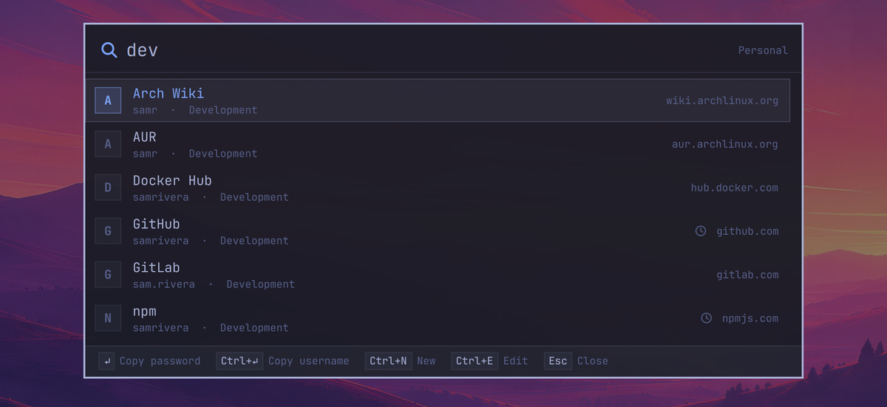
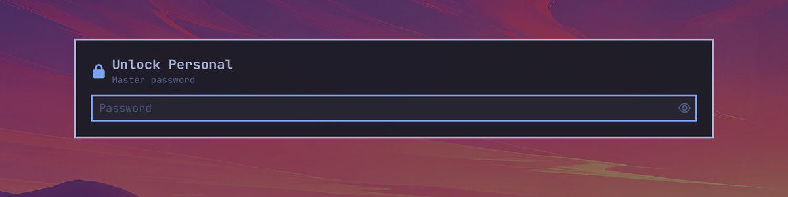
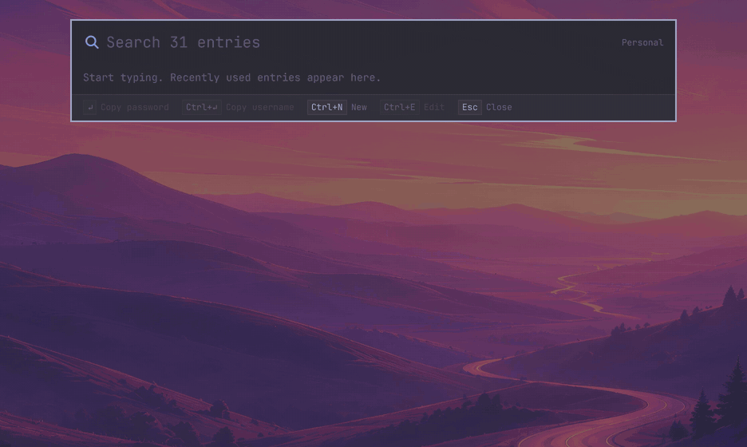
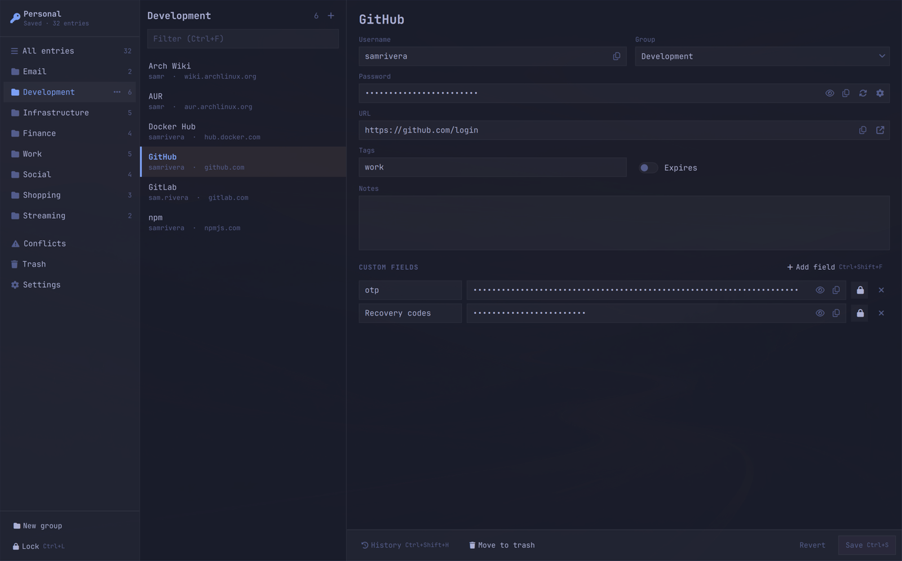
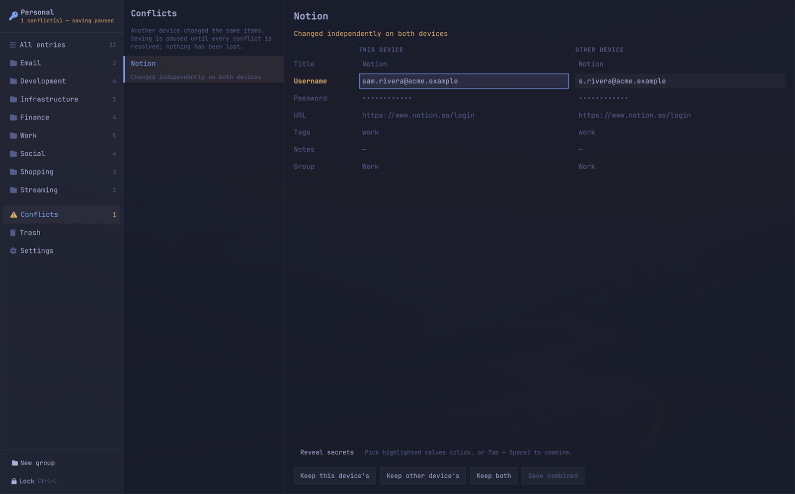
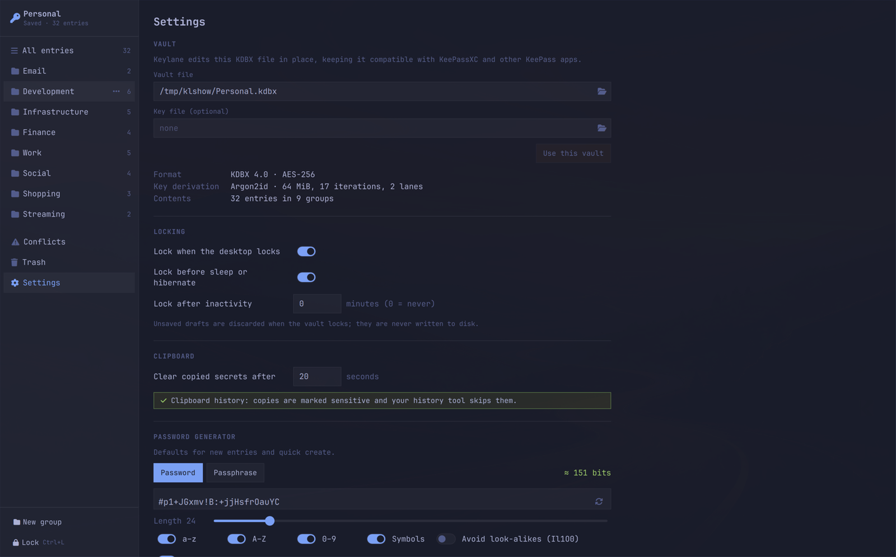

<div align="center">

# Keylane

**A keyboard-first password manager for Linux and Wayland that reads and
writes standard KeePass (KDBX) files.**

One shortcut opens it, a few letters find the entry, and Enter copies the
password. Your vault stays an ordinary `.kdbx` file that KeePassXC, KeePassDX
and Strongbox can still open.


</div>

## Why Keylane

- **Copy a password in under a second.** The launcher is a layer-shell
  overlay on the active monitor, so it never reshuffles your tiled windows.
  Search covers titles, groups, URLs and tags, and tolerates typos (`githbu`)
  and initials (`boe` finds *Bank of Example*). With 10,000 entries it opens
  in about 8 ms and updates results in about 14 ms (p50, see
  [docs/PERFORMANCE.md](docs/PERFORMANCE.md)).
- **Clipboard hygiene.** Copied secrets are marked sensitive so clipboard
  history tools skip them, and they are cleared after 20 s.
- **Create entries without touching the mouse.** If a search finds nothing,
  Ctrl+N turns the query into a new entry with a strong password already
  generated. Enter saves and copies it.
- **A full manager when you need one**, covering groups, custom fields,
  attachments, history, trash and the generator. The keyboard drives all of it.
- **Safe on OneDrive, Syncthing and Dropbox.** Writes are atomic, and edits
  are merged against a three-way baseline. When two devices change the same
  field, you choose which version to keep; nothing is lost
  ([docs/SYNC.md](docs/SYNC.md)).
- **Lossless KeePass compatibility.** Keylane edits KDBX 3.1 and 4.x files
  in place, preserving fields it doesn't understand. Interop is tested against
  `keepassxc-cli` ([docs/FORMATS.md](docs/FORMATS.md)).
- **Locks when it should.** It locks on desktop lock, suspend and shutdown,
  and drops plaintext *before* sleep. There is no surprise inactivity timer
  unless you set one ([docs/SECURITY.md](docs/SECURITY.md)).
- **Looks at home on Omarchy.** It uses your live Omarchy palette and font,
  follows theme changes instantly, and falls back to light or dark themes on
  other desktops.

## Tour

<table>
<tr>
<td width="50%"><br><sub><b>Launcher.</b> Results show user, group and site. Hints for every key are in the footer.</sub></td>
<td width="50%"><br><sub><b>Unlock.</b> The same overlay asks for your master password. Keylane always starts locked.</sub></td>
</tr>
</table>

### Create in place



### Manager



### Sync conflicts, resolved field by field

When another device edited the same entry, Keylane pauses saving and shows
both versions side by side. You can keep either version, keep both, or pick
individual fields.



### Settings and generator



<sub>All screenshots use a synthetic demo vault.</sub>

## Quick start

Arch-based systems (including Omarchy) need these packages:

```sh
sudo pacman -S --needed pyside6 python-pykeepass python-rapidfuzz layer-shell-qt wl-clipboard
git clone https://github.com/alexpomsft/keylane && cd keylane
python -m venv --system-site-packages .venv
.venv/bin/pip install -e .
ln -s "$PWD/.venv/bin/keylane" ~/.local/bin/keylane
keylane                                           # opens the launcher; first run offers create/open
```

If you can't install the `layer-shell-qt` package, `scripts/fetch-layershell.sh`
fetches a private copy. There is also an Arch package recipe in
[`packaging/PKGBUILD`](packaging/PKGBUILD). See
[docs/INSTALL.md](docs/INSTALL.md) for other distributions.

Bind it to a key yourself (Keylane never edits your compositor config):

```lua
-- Omarchy, ~/.config/hypr/bindings.lua (pick a free chord, or unbind the old one first)
o.bind("SUPER + ALT + K", "Keylane", "keylane")
```

For classic `hyprland.conf` syntax and other setups, see
[docs/INSTALL.md](docs/INSTALL.md).

### Omarchy bar widget

[omarchy-keylane](https://github.com/alexpomsft/omarchy-keylane) adds a lock
icon to the Omarchy bar that shows whether the vault is unlocked. Left-click
opens the launcher, middle-click opens the manager, and right-click locks:

```sh
omarchy plugin add https://github.com/alexpomsft/omarchy-keylane --enable
```

## Launcher keys

| Key | Action |
|---|---|
| type | search |
| ↑/↓, Tab/Shift+Tab, Ctrl+J/K, PgUp/PgDn | move |
| Enter | copy password |
| Ctrl+Enter | copy username |
| Ctrl+U | copy URL |
| Ctrl+N | create (title prefilled from the query) |
| Ctrl+E | edit in the manager |
| Ctrl+L | lock |
| Esc | clear the query, then close |

In the create form: Tab moves through the fields, Enter saves and copies the
password, Ctrl+S saves only, Ctrl+E opens the draft in the manager, and Esc
returns to search.

The manager shows its shortcuts in tooltips and button hints. The main ones:

| Key | Action |
|---|---|
| Ctrl+N | new entry |
| Ctrl+F or `/` | search |
| Ctrl+G | groups |
| Ctrl+S | save |
| Ctrl+H | reveal |
| Ctrl+R | generate |
| Ctrl+Shift+R | generator options |
| Ctrl+Shift+F | add field |
| Ctrl+Shift+H | history |
| Ctrl+C / Ctrl+B / Ctrl+U | copy password / username / URL |
| Delete | move to trash |
| Ctrl+L | lock |
| Ctrl+, | settings |
| Ctrl+W | close |
| Ctrl+Q | quit |

## Command line

```
keylane [search [QUERY]] | new [TITLE] | manager | settings | lock | status | quit | daemon | version
```

The first command starts the resident process, which always starts locked.
Later commands reach it over a same-user socket in a few milliseconds. The
CLI never accepts or prints secrets.

## Configuration

`~/.config/keylane/config.toml` is written by the Settings page. Invalid values
fall back to defaults with a visible warning.

```toml
[vault]
path = "~/OneDrive/keys.kdbx"
keyfile = ""                        # optional
[security]
lock_on_desktop_lock = true
lock_on_sleep = true
inactivity_timeout_minutes = 0      # 0 = off (default); 1–1440
clipboard_seconds = 20              # 5–600
[backups]
keep = 20                           # 1–500 encrypted snapshots
min_interval_minutes = 5
[appearance]
theme = "auto"                      # auto | omarchy | dark | light
[diagnostics]
log_level = "info"                  # info | debug (never logs secrets)
```

## Documentation

| Document | Contents |
|---|---|
| [ARCHITECTURE](docs/ARCHITECTURE.md) | processes, modules, stack decisions |
| [SECURITY](docs/SECURITY.md) | threat model, lock semantics, clipboard, memory limits |
| [FORMATS](docs/FORMATS.md) | supported KDBX revisions, ciphers, KDFs, key files |
| [SYNC](docs/SYNC.md) | reconciliation, baseline, backups, recovery |
| [PERFORMANCE](docs/PERFORMANCE.md) | method and results of the 10k-entry benchmark |
| [GENERATOR](docs/GENERATOR.md) | password and passphrase defaults, EFF word list |
| [INSTALL](docs/INSTALL.md) | dependencies, packaging, key binding, uninstall |

## Development

```sh
.venv/bin/python -m pytest                 # unit, interop (keepassxc-cli) and property tests
.venv/bin/python scripts/bench.py          # search engine benchmark (headless)
.venv/bin/python scripts/bench.py --desktop  # end-to-end launcher latency (needs wtype + Hyprland)
KEYLANE_QML_DEV=1 keylane daemon           # reload QML from the source tree
```

## License

GPL-3.0-or-later. The EFF large word list is © Electronic Frontier Foundation,
used under CC BY 3.0 (see [docs/GENERATOR.md](docs/GENERATOR.md)).
